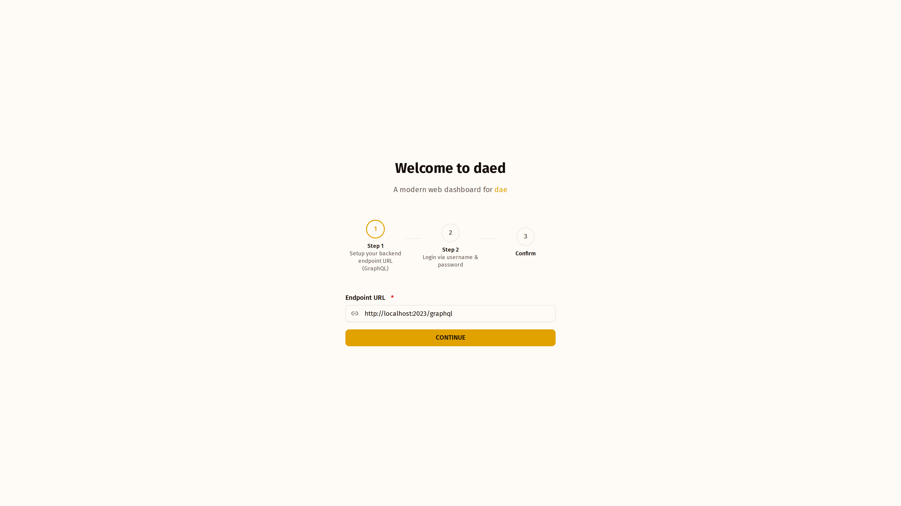
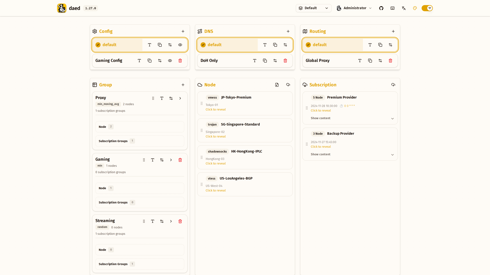
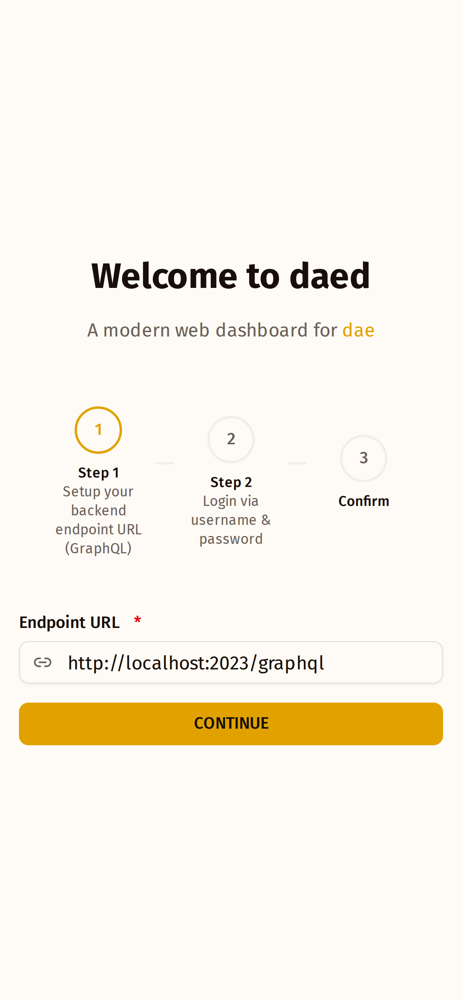
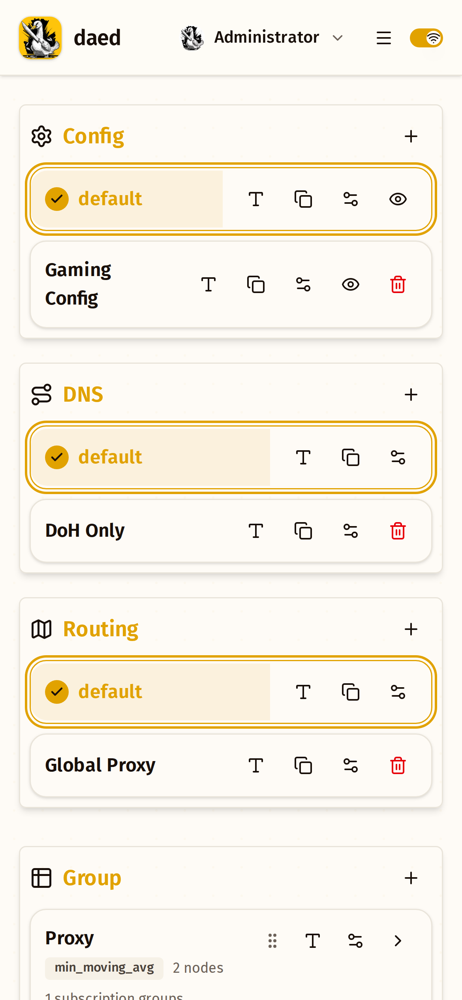

<div align="center">
  
  <h1>daed</h1>
  <p><strong>A modern web dashboard for dae</strong></p>

  <p>
    <a href="https://github.com/1unns/daed/actions/workflows/ci.yml"></a>
    <a href="https://github.com/1unns/daed/blob/main/LICENSE"></a>
    <a href="https://github.com/1unns/daed/pulls"></a>
    <a href="https://github.com/daeuniverse/daed/releases"></a>
  </p>

  <p>
    <a href="#features">Features</a> •
    <a href="#getting-started">Getting Started</a> •
    <a href="#development">Development</a> •
    <a href="#contributing">Contributing</a> •
    <a href="#license">License</a>
  </p>
</div>

---

## ⚠️ This Is a Development Fork

> **This repository (`1unns/daed`) is a development fork. It is *not* an official distribution channel.**
>
> - Official releases are produced and published by [**daeuniverse/daed**](https://github.com/daeuniverse/daed). Install from there unless you specifically want to test unreleased work.
> - The `Release` badge above, the Docker images, and the distribution packages all refer to the **upstream** project. Artifacts built from this fork are unsigned, untagged, and not covered by any upstream support commitment.
> - `wing` and `dae-core` are pinned to [`1unns/dae-wing`](https://github.com/1unns/dae-wing) and [`1unns/dae`](https://github.com/1unns/dae), not to the upstream repositories. Code in this fork may therefore differ from what upstream ships.
> - Please report bugs you hit **in official releases** to [daeuniverse/daed/issues](https://github.com/daeuniverse/daed/issues). Report issues specific to this fork to [1unns/daed/issues](https://github.com/1unns/daed/issues).
>
> For the governance and security implications of this split, see [`SECURITY.md`](./SECURITY.md).

---

## 📸 Screenshots

<details open>
<summary><b>Desktop Screenshots</b></summary>

|                                Setup                                |                                   Orchestrate                                   |
| :-----------------------------------------------------------------: | :-----------------------------------------------------------------------------: |
|  |  |

</details>

<details>
<summary><b>Mobile Screenshots</b></summary>

|                                  Setup                                  |                                     Orchestrate                                     |
| :---------------------------------------------------------------------: | :---------------------------------------------------------------------------------: |
|  |  |

</details>

---

## ✨ Features

- 🎨 **Beautiful UI** — Modern, intuitive interface with light/dark mode support
- ⌨️ **Keyboard First** — Built-in keyboard navigation and shortcuts for power users
- 📱 **Responsive** — Fully mobile-friendly design
- 🚀 **Fast** — Built with React and optimized for performance

## 🌐 Online Demo

Try daed directly in your browser without installation:

**🔗 [daeuniverse.github.io/daed](https://daeuniverse.github.io/daed)**

> ⚠️ **Important:** Since GitHub Pages uses HTTPS, your dae-wing backend must also be served over HTTPS. Browsers block mixed content (HTTPS page connecting to HTTP backend). Configure a reverse proxy with TLS or use a self-signed certificate for local development.

## 🚀 Getting Started

Please refer to the [Quick Start Guide](./docs/getting-started.md) to start using daed right away!

## 🐳 Docker Deployment

Pull the prebuilt image:

```bash
docker pull ghcr.io/daeuniverse/daed
```

Run the container:

```bash
docker run -d \
    --privileged \
    --network=host \
    --pid=host \
    --restart=always \
    -v /sys:/sys \
    -v /etc/daed:/etc/daed \
    --name=daed \
    ghcr.io/daeuniverse/daed:latest
```

Or use Docker Compose:

```yaml
# docker-compose.yml
services:
  daed:
    image: ghcr.io/daeuniverse/daed
    container_name: daed
    privileged: true
    network_mode: host
    pid: host
    restart: always
    volumes:
      - /sys:/sys
      - /etc/daed:/etc/daed
```

```bash
docker compose up -d
```

Access the dashboard at `http://localhost:2023`.

## 💻 Development

### Prerequisites

- [Node.js](https://nodejs.org/) >= 22
- [pnpm](https://pnpm.io/) 10.24.0 — pinned in the `packageManager` field of `package.json`

The frontend alone needs no Go toolchain. Building the `daed` binary does; see
[`docs/build.md`](./docs/build.md) for the Go, Clang and LLVM prerequisites.

### Setup

```bash
# Clone with submodules. wing/ and the nested wing/dae-core/ hold the Go backend
# and the eBPF data plane; without them `make` cannot build a binary.
git clone --recursive https://github.com/1unns/daed.git
cd daed

# Install dependencies
pnpm install

# Start development server
pnpm dev
```

Already cloned without `--recursive`? Run `git submodule update --init --recursive`.

### Available Scripts

| Command            | Description                        |
| ------------------ | ---------------------------------- |
| `pnpm dev`         | Start development server           |
| `pnpm build`       | Build for production               |
| `pnpm lint`        | Lint and fix code                  |
| `pnpm test`        | Run the test suites                |
| `pnpm check-types` | Type-check without emitting        |
| `pnpm codegen`     | Generate GraphQL types             |

## 🧰 Operations

Operating an instance — backup, upgrade, rollback, credential rotation, incident
response — is documented step by step in the
[Runbook](./docs/RUNBOOK.md). It is written so that someone other than the author
can recover an instance using the document alone.

## 🤝 Contributing

Contributions are welcome! Whether it's bug reports, feature requests, or pull requests — all are appreciated.

Please read our [Contributing Guide](./CONTRIBUTING.md) before submitting a PR.

Special thanks to all [contributors](https://github.com/daeuniverse/daed/graphs/contributors)! ❤️

<a href="https://github.com/daeuniverse/daed/graphs/contributors">
  
</a>

## 📄 License

This project is dual licensed:

- Frontend (daed): [MIT License](./LICENSE)
- Backend (dae-wing): [AGPL-3.0 License](https://github.com/daeuniverse/dae-wing/blob/main/LICENSE)

---

<div align="center">
  Made with ❤️ by <a href="https://github.com/daeuniverse">@daeuniverse</a>
</div>
